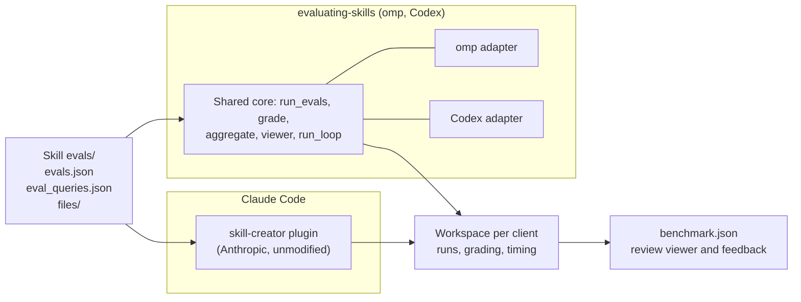

# sonsu-marketplace

Personal plugin marketplace for omp, Codex, and Claude Code.

[omp](https://github.com/can1357/oh-my-pi) reads `.omp-plugin/marketplace.json`;
[Codex](https://developers.openai.com/codex/cli) reads
`.agents/plugins/marketplace.json`; [Claude Code](https://code.claude.com/docs/en/overview)
reads `.claude-plugin/marketplace.json`. All three install the same `plugins/`
packages.

## Table of Contents

- [Install](#install)
  - [Dependencies](#dependencies)
  - [Marketplace](#marketplace)
- [Usage](#usage)
  - [CLI](#cli)
- [Available plugins](#available-plugins)
  - [git-workflow](#git-workflow)
  - [skill-workflow](#skill-workflow)
  - [ticket-workflow](#ticket-workflow)
  - [decision-workflow](#decision-workflow)
  - [writing-workflow](#writing-workflow)
  - [review-workflow](#review-workflow)
  - [planning-workflow](#planning-workflow)
  - [design-workflow](#design-workflow)
- [Layout](#layout)
- [Contributing](#contributing)
  - [Code review](#code-review)
  - [Writing documentation](#writing-documentation)
  - [Decision records](#decision-records)
  - [Adding a plugin](#adding-a-plugin)
  - [Testing a plugin](#testing-a-plugin)
- [License](#license)

## Install

### Dependencies

Install [omp](https://github.com/can1357/oh-my-pi#install),
[Codex CLI](https://developers.openai.com/codex/cli), or
[Claude Code](https://code.claude.com/docs/en/overview) before using this
marketplace. Codex and Claude Code must provide the plugin marketplace and
subagent interfaces described below; older clients without them do not meet
the prerequisites. Local catalog installation and installed-skill discovery
were checked with Codex CLI `0.163.0`, omp `18.12.6`, and Claude Code
`2.1.304`, the versions the `checks` workflow installs. These are checked
baselines, not promises for every older release or evidence of authenticated
model execution.

The `git-workflow` skills reuse the target repository's validation setup first.
When none exists, the commit fallback needs Node.js 22.12.0 or newer and npm
(`npx`), while the branch fallback needs uv (`uvx`) and Python 3.10 or newer.
The first uncached fallback run needs access to its package registry.

Publishing pull requests needs an authenticated GitHub tool. Native media
uploads use GitHub CLI's `--attach` support and require push access to the target
repository. Capturing UI evidence needs suitable capture and annotation tools.

Publishing tickets needs authenticated tooling for the selected GitHub repository
or Linear workspace. `ticket-workflow` does not bundle credentials or configure
tracker integrations.

The `writing-workflow` plugin includes Python-based Korean and Japanese checks.
See its [dependencies and source notices](plugins/writing-workflow/README.md)
before use. Its English skill has no external runtime dependency.

The `skill-workflow` plugin's `evaluating-skills` scripts need Python 3.11 or
newer, Git, and the omp or Codex CLI being evaluated; with an older `python3`,
they exit and print the equivalent `uv run --no-project --python 3.12`
command. Claude Code evaluations use Anthropic's `skill-creator` plugin from
`claude-plugins-official`.

### Marketplace

For omp, add the marketplace:

```sh
omp plugin marketplace add sonsu-lee/sonsu-marketplace
```

List its plugins and install one:

```sh
omp plugin discover sonsu-marketplace
omp plugin install <plugin>@sonsu-marketplace
```

Add `--scope project` to install a plugin for the current project only.

For Codex:

```sh
codex plugin marketplace add sonsu-lee/sonsu-marketplace
codex plugin list --marketplace sonsu-marketplace --available --json
codex plugin add git-workflow@sonsu-marketplace
```

For Claude Code:

```sh
claude plugin marketplace add sonsu-lee/sonsu-marketplace
claude plugin install git-workflow@sonsu-marketplace
```

Use `codex plugin add <name>@sonsu-marketplace` or
`claude plugin install <name>@sonsu-marketplace` for another package; Claude
Code also accepts `--scope project`. This is a repository marketplace, not a
submission to a public plugin directory. The common local marketplace format
also applies to supporting app and IDE surfaces; their availability varies,
and CLI checks do not verify those UIs.

## Usage

### CLI

In omp, check available skills after installation:

```sh
omp skill list
```

In Codex, check catalog and installed state:

```sh
codex plugin list --marketplace sonsu-marketplace --json
```

In Claude Code, check installed state and a package's components:

```sh
claude plugin list
claude plugin details git-workflow
```

Listing proves catalog or installation state, not skill execution. In a Codex
session, explicitly select the installed plugin skill as `$<plugin>:<skill>`,
for example `$git-workflow:writing-commits`. A bare `$writing-commits` does not
select that plugin skill on the checked CLI baseline. In Claude Code, invoke it
as `/<plugin>:<skill>`, for example `/git-workflow:writing-commits`. Retain the
qualified name returned by discovery when invoking skills or matching results.
Natural-language selection is model behavior, not an installation hook or
guaranteed trigger.

In an omp session, `/marketplace` opens the catalog in the plugin browser.
Installed skills provide guidance for relevant requests; for example, ask omp to
name a branch or write a commit message when using `git-workflow`.
Ask to draft, create, or update a pull request to use `writing-pull-requests`.
New PRs are Draft by default.
Ask to create, revise, or simplify an agent skill to use `authoring-skills`
from `skill-workflow`.
Ask to draft, create, update, or split GitHub Issues or Linear tickets to use
`writing-tickets` from `ticket-workflow`. Draft requests do not publish issues.
Ask whether a design choice warrants an ADR, or ask to draft, review, or
supersede one, to use `writing-adrs` from `decision-workflow`. It does not
create a decision record for every implementation change.

Ask to write or refine Korean, English, or Japanese prose to use
`writing-workflow`. Korean technical documentation is included; protected code,
identifiers, quotations, numbers, and terminology remain unchanged.

Ask to review code, a diff, a branch, or a PR to use `reviewing-code` from
`review-workflow`. omp pairs a native reviewer with focused custom workers;
Codex and Claude Code use independent custom general and focused subagents.
Explicit native-only requests retain `/review`, `codex review`, or Claude
Code's `/code-review` without orchestration. Reviews stay local unless you
request publication; a comment draft is not posted.

Ask for an interface proposal, a read-only design review, or standalone graphics
to use `design-workflow`. Its optional omp runtime requires explicit operator
approval and real capture/check evidence; the shared skills alone do not enforce
that workflow. See the [design guide](plugins/design-workflow/README.md).

For omp, fetch catalog changes, then upgrade installed plugins:

```sh
omp plugin marketplace update sonsu-marketplace
omp plugin upgrade
```

For Codex, refresh a Git-backed marketplace:

```sh
codex plugin marketplace upgrade sonsu-marketplace
```

An absolute local marketplace path is used directly and cannot be refreshed
with `marketplace upgrade`; that command requires a configured Git source.

For Claude Code, refresh the catalog, then update an installed plugin:

```sh
claude plugin marketplace update sonsu-marketplace
claude plugin update git-workflow@sonsu-marketplace
```

Claude Code loads plugins from a local-path marketplace in place, so their
source edits take effect at the next session without a version change.

## Available plugins

### git-workflow

Install with `omp plugin install git-workflow@sonsu-marketplace`,
`codex plugin add git-workflow@sonsu-marketplace`, or
`claude plugin install git-workflow@sonsu-marketplace`.

- **`writing-commits`** writes Conventional Commit messages and validates them
  before use. It reuses repository commands, tools, versions, and configuration.
  Only without an existing execution setup does it run pinned commitlint through
  `npx`; only without configuration does it use bundled ESM defaults. See the
  [skill's validation procedure](plugins/git-workflow/skills/writing-commits/SKILL.md#required-validation).
- **`naming-branches`** names and validates branches with Conventional Branch
  1.1.0, reusing repository validation first. Without an execution setup it runs
  pinned `commit-check` through `uvx`; repository configuration still takes
  precedence over bundled defaults. This is a Python CLI, not an npm package.
  The skill's default prefixes are `feat/` (not `feature/`), `bugfix/` (not
  `fix/`), `hotfix/`, `release/`, and `chore/`. See the
  [skill's validation procedure](plugins/git-workflow/skills/naming-branches/SKILL.md#required-validation).
- **`writing-pull-requests`** writes plain, repository-aware PR descriptions,
  selecting review-relevant context instead of reproducing work logs. It records
  author checks, labels AI assistance, and prepares UI evidence. Dependent PRs
  use GitHub stacks where available; new PRs are Draft by default. See the
  [PR writing procedure](plugins/git-workflow/skills/writing-pull-requests/SKILL.md).

Branch prefixes do not change commit types: a `bugfix/` branch can contain
`fix`, `test`, and other commits. A missing dependency or failed configured
validator is not an absent setup and must not trigger a fallback. These skills
provide agent workflow instructions, not Git hooks or CI enforcement.

### skill-workflow

Install with `omp plugin install skill-workflow@sonsu-marketplace`,
`codex plugin add skill-workflow@sonsu-marketplace`, or
`claude plugin install skill-workflow@sonsu-marketplace`.

- **`authoring-skills`** creates, revises, and reviews focused agent skills
  using common Agent Skills principles, without a default client. It identifies
  the intended consumer from the request and project context, then loads only
  the relevant omp, Claude, or Codex considerations. It keeps judgment in the
  skill and delegates mechanical work to existing tools. Its checks distinguish
  discovery from complete prompt loading and task behavior; version-specific
  limits belong in client references, not common format rules. It routes
  behavior and activation evaluation to `skill-creator` in Claude Code or
  `evaluating-skills` for omp and Codex. See the
  [skill-authoring procedure](plugins/skill-workflow/skills/authoring-skills/SKILL.md).
- **`evaluating-skills`** runs the Agent Skills evaluation loops against omp
  and Codex from any client with a shell: each skill's `evals/evals.json`
  prompts with and without the skill or against its previous version, graded
  assertions, a pass-rate, time, and token benchmark, a review viewer for human
  feedback, and description tuning against `evals/eval_queries.json`. It ports
  the client-independent parts of Anthropic's skill-creator under the Apache
  License 2.0 and adds omp and Codex adapters; Claude Code results come from
  the skill-creator plugin itself. See the
  [skill evaluation procedure](plugins/skill-workflow/skills/evaluating-skills/SKILL.md).
- **`skill-workflow-reviewer`** is an omp agent that autoloads
  `authoring-skills` and reviews a fixed skill change read-only, without
  running checks. In omp, `authoring-skills` dispatches it after creating a
  skill or changing its behavior, and `reviewing-code` adds it when a reviewed
  change touches a skill. Codex and Claude Code have no such agent; they start
  an equivalent generic worker only on explicit request.

This plugin does not install skills or configure projects. Plugin packaging
and marketplace checks remain in the contributor procedures below.

### ticket-workflow

Install with `omp plugin install ticket-workflow@sonsu-marketplace`,
`codex plugin add ticket-workflow@sonsu-marketplace`, or
`claude plugin install ticket-workflow@sonsu-marketplace`.

- **`writing-tickets`** writes plain, outcome-centered GitHub and Linear tickets.
  It follows project templates first; otherwise a clear title or one or two
  sentences can be the entire ticket. Bodies hold the current agreement, not
  accumulated investigation or progress logs, while retaining essential
  constraints. It also reviews labels,
  assignment, priority, estimates, and milestones, proposing grounded metadata
  separately from the body using the tracker's actual fields and conventions.
  Optional unknowns remain unset rather than guessed. Bug reports and parent
  tickets add kind-specific guidance, and suspected vulnerabilities follow the
  project's private reporting path instead of a public ticket. See the
  [ticket-writing procedure](plugins/ticket-workflow/skills/writing-tickets/SKILL.md)
  and [fallback template](plugins/ticket-workflow/skills/writing-tickets/assets/ticket-body.md).

Use ticket, then work, then PR as the normal development flow. Tickets and PRs
need not be one-to-one; partial work should not close the whole ticket.
Install `git-workflow` for downstream branch naming and PR preparation; it is not
needed to draft tickets. The ticket plugin respects existing tracker sync and
templates but does not configure them, publish duplicate issues to both trackers,
or enforce ticket-first work through hooks.

### decision-workflow

Install with `omp plugin install decision-workflow@sonsu-marketplace`,
`codex plugin add decision-workflow@sonsu-marketplace`, or
`claude plugin install decision-workflow@sonsu-marketplace`.

- **`writing-adrs`** selects decisions worth recording and writes short ADRs
  with context, a decision and its rationale, rejected alternatives, and
  consequences. It follows the target project's scope, template, and lifecycle
  first; without those, it uses direction-setting and consequential design
  choices as its boundary. See the
  [ADR writing procedure](plugins/decision-workflow/skills/writing-adrs/SKILL.md)
  and [default template](plugins/decision-workflow/skills/writing-adrs/assets/adr.md).

The principles follow Martin Fowler's ADR guidance, and the default template
is adapted from Evolu. Drafts remain proposed until the decision-maker accepts
them; changing an accepted decision requires a linked replacement. This plugin
does not install hooks, impose a format on existing repositories, or turn
routine work into ADRs.

### writing-workflow

Install with `omp plugin install writing-workflow@sonsu-marketplace`,
`codex plugin add writing-workflow@sonsu-marketplace`, or
`claude plugin install writing-workflow@sonsu-marketplace`.

- **`humanize-korean`** adapts `epoko77-ai/im-not-ai` for natural Korean
  editing across genres, including technical documentation, README files,
  API references, runbooks, and prose around code. For new writing, compose a
  draft from the supplied material first, then refine it with the skill.
- **`ce-noslop`** adapts Every's English writing, editing, and diagnostic
  guidance for clear prose, preserving facts and the requested register.
- **`natural-japanese`** adapts coji's Japanese drafting, editing, and
  diagnostic workflow, including document-specific guidance and author voice.

Use one editorial skill for the language being written; do not run competing
humanizers over the same text. These are writing workflows, not translation
services or reliable AI-authorship detectors. Read the
[plugin guide](plugins/writing-workflow/README.md) for examples, dependencies,
upstream revisions, and licenses. Mechanical checks do not establish naturalness
or complete semantic preservation.

### review-workflow

Install with `omp plugin install review-workflow@sonsu-marketplace`,
`codex plugin add review-workflow@sonsu-marketplace`, or
`claude plugin install review-workflow@sonsu-marketplace`.

Evidence-driven code review with independent general and focused reviewers and
local-first reporting.

- **`reviewing-code`** reviews intent, flow, failures, architecture, and internal
  implementation. omp uses a native `reviewer` plus `review-workflow-focused`;
  Codex and Claude Code use fresh generic subagents assigned general and focused
  roles. They inspect the same frozen target independently, without sharing
  initial conclusions. Models follow effective client settings, not a fixed
  provider pair. When a reviewed change touches a skill, omp adds
  `skill-workflow-reviewer` if `skill-workflow` is installed; for a skill-only
  change it replaces `review-workflow-focused`. Codex and Claude Code add a
  skill-criteria worker only on explicit request. Runtime
  verification and high-risk red-team challenges are separate, bounded work
  rather than repeated full reviews.
- Reviews report locally by default. Comment drafting and explicit publication
  use [review-comment guidance](plugins/review-workflow/skills/reviewing-code/references/review-comments.md)
  that preserves evidence, uncertainty, and the difference between fixes and
  optional suggestions.

Read the [plugin guide](plugins/review-workflow/README.md) for model access,
workspace isolation, runtime verification, and cost boundaries. The plugin does
not install hooks, automatically fix code, or configure credentials.

### planning-workflow

Install with `omp plugin install planning-workflow@sonsu-marketplace`,
`codex plugin add planning-workflow@sonsu-marketplace`, or
`claude plugin install planning-workflow@sonsu-marketplace`.

- **`planning-work`** plans non-trivial work, such as a feature, a change
  spanning several pull requests, or product and UI planning, as a design to
  approve before implementation. It distinguishes the requested deliverable
  from the intended outcome without expanding scope, reads available context,
  and asks only about unknowns that would change the plan. Where consequential
  assumptions are uncertain, it seeks direct evidence, concrete methods, and
  external checks that could disprove them. It traces requirements through the
  design, considers reachable edge cases, plans verification and delivery,
  and marks the plan Draft or Decided. It uses an independent reader where
  available (otherwise disclosing self-review), which is not proof the plan works,
  and waits for explicit approval. See the
  [planning procedure](plugins/planning-workflow/skills/planning-work/SKILL.md).

Small, clear changes need no plan. The plugin does not implement the work,
write tickets, ADRs, or pull requests, or install hooks that require a plan.

### design-workflow

Install with `omp plugin install design-workflow@sonsu-marketplace`,
`codex plugin add design-workflow@sonsu-marketplace`, or
`claude plugin install design-workflow@sonsu-marketplace`.

- **`designing-interfaces`** creates or improves interface layouts, hierarchy,
  responsive behavior and interaction states, including proposals without edits.
- **`reviewing-designs`** evaluates existing designs without modifying them and
  distinguishes observed issues from assumptions.
- **`designing-graphics`** creates standalone icons, illustration and identity
  assets with reproduction and handoff constraints.

The [plugin guide](plugins/design-workflow/README.md) describes an optional omp
extension with operator-approved scope, controlled tools, real browser/process
receipts, revision-bound review and explicit non-success exits. Codex and Claude
Code receive guidance only. This is not an OS sandbox or an automatic design
quality certification.

## Layout

```text
.omp-plugin/
  marketplace.json            # catalog: name, owner, plugins[]
.agents/plugins/
  marketplace.json            # Codex catalog: same package roots
.claude-plugin/
  marketplace.json            # Claude Code catalog: same package roots
.github/
  actions/setup-clients/      # installs the CI toolchain and locked clients
  ci-clients/                 # omp, Codex, Claude Code versions and bun.lock
  workflows/checks.yml        # model-free checks on every pull request
  workflows/pr-title.yml      # PR title against the commit rules
plugins/
  <name>/
    plugin.json               # shared identity, version, standard metadata
    skills/<skill>/SKILL.md   # Agent Plugins: skills
    skills/<skill>/evals/     # Agent Skills evals: evals.json,
                              #   eval_queries.json, files/
    mcp.json                  # Agent Plugins: MCP servers
    commands/<command>.md     # omp: slash commands, run as /<name>:<command>
    agents/<agent>.md         # omp: task subagents
    rules/<rule>.md           # omp: rules
    package.json              # omp: extension modules under "omp.extensions"
    .claude-plugin/plugin.json  # Claude Code: only to exclude omp agents
scripts/
  check_plugins.py            # model-free checks for omp, Codex, Claude Code
  check_version_bumps.py      # changed plugins raised their version
  tests/                      # model-free tests for check_plugins and
                              #   evaluating-skills
```

Each plugin is an [Agent Plugins](https://agent-plugins.org/) 1.0.0 package.
All three catalogs point to the same `plugins/<name>` directories, relative to
the repository root. Standard metadata, skills, scripts, and assets are shared;
omp agents and client-specific execution references remain separate.
omp-specific components use omp's conventional locations because omp does not
yet read the standard's `extensions` field or namespaced extension directories.
Claude Code takes its manifest from the catalog entry or a package's
`.claude-plugin/plugin.json`, not from the root `plugin.json` or `mcp.json`.
Claude Code `2.1.296` still records the root `version` at installation, so
keep every declared version equal.
Everything except `plugin.json` is optional. Do not duplicate package trees,
add `.codex-plugin` overlays, symlinks, or empty MCP files for these packages.
The packaging rationale remains [ADR-0002](docs/decisions/0002-plugin-format.md);
the proposed cross-client design is
[ADR-0005](docs/decisions/0005-share-plugins-across-clients.md).

## Contributing

Pull requests are welcome. Ask questions or report problems in
[GitHub Issues](https://github.com/sonsu-lee/sonsu-marketplace/issues). Follow the
[PR writing procedure](plugins/git-workflow/skills/writing-pull-requests/SKILL.md)
when preparing a PR. For plugin changes, follow the authoring and testing
procedures below.

### Code review

Apply [Code Review Rules](AGENTS.md#code-review-rules) when reviewing changes
and interpreting feedback. Requested plugin reviews use the
[reviewing-code procedure](plugins/review-workflow/skills/reviewing-code/SKILL.md)
and the matching [omp execution reference](plugins/review-workflow/skills/reviewing-code/references/omp.md),
[Codex execution reference](plugins/review-workflow/skills/reviewing-code/references/codex.md),
or [Claude Code execution reference](plugins/review-workflow/skills/reviewing-code/references/claude-code.md).
omp dispatches native and focused reviewers, plus `skill-workflow-reviewer` when
the change touches a skill; Codex and Claude Code dispatch independent custom
general and focused reviewers. Explicit native-only requests retain `/review`,
`codex review`, or `/code-review`, without plugin
orchestration. Preserve native output and priority contracts only when using a
native reviewer; custom controllers use the common skill's report contract.
Results stay local unless publication is explicitly requested; a draft is not
permission to post. These procedures do not replace required approvals or
branch protections.

When responding to review:

1. Evaluate the observation, whether it needs a change in this PR, and the
   proposed solution separately. A valid observation does not automatically
   justify the suggested implementation or a new rule.
2. Address in-scope defects with the smallest sufficient change. Explain
   declined or deferred feedback in the existing discussion; do not turn
   non-blocking advice into required work or silently expand the PR's purpose.
3. On re-review, check the agreed correction and its effects against the
   original requirement. New consequential defects remain reportable; a
   different preference alone is not a reason to reopen a settled choice.

The local policy draws on [Codex customization][codex-review],
[Google's review standard][review-standard], and
[Conventional Comments][review-comments]. Comment intent labels do not override
Codex's supported output or priority filtering. Refine the guidance against
actual review results, narrowing or removing rules that produce noise.

[codex-review]: https://learn.chatgpt.com/docs/third-party/github#customize-what-codex-reviews
[review-standard]: https://google.github.io/eng-practices/review/reviewer/standard.html
[review-comments]: https://conventionalcomments.org/

### Writing documentation

Write documentation in English and follow the
[Standard Readme specification](https://github.com/RichardLitt/standard-readme/blob/main/spec.md)
when creating or updating README files, as recorded in
[ADR-0003](docs/decisions/0003-use-standard-readme.md).

For root and plugin READMEs:

- Use the project name as the title and a short description under 120
  characters, consistent with package and repository metadata where applicable.
- Include `Install`, `Usage`, `Contributing`, and a final `License` section in
  that order. The license section identifies the license and its owner.
- Include a table of contents for documents of 100 lines or more and keep its
  links synchronized with headings.
- Show installation and common usage in code blocks. Put manually installed
  prerequisites under `Install` / `Dependencies` and CLI examples under
  `Usage` / `CLI` where applicable.
- Put marketplace-specific sections after `Usage`, and authoring and testing
  procedures under `Contributing`. State where to ask questions and whether
  pull requests are accepted.
- Omit optional sections that add no value. Keep decision rationale in ADRs.
- Inspect rendered navigation and code blocks, check links and license
  information, and exercise changed CLI examples. Use isolated client homes
  and follow the plugin test procedure below, including Codex's `CODEX_HOME`
  and Claude Code's `CLAUDE_CONFIG_DIR`.

Repository Markdown files follow the lint policy in
[ADR-0004](docs/decisions/0004-require-markdown-lint.md), including READMEs, ADRs,
agent instructions, skills, commands, and rules. Before pushing, use Node.js 22
or newer and npm to check the files added or modified by your change, using the
pinned CLI's default rules:

```sh
npx --yes markdownlint-cli@0.49.1 README.md
```

Append the paths of any other Markdown files added or modified by your change,
including ADRs. Fix all reported lint errors, then check links and the rendered
Markdown; lint does not verify Standard Readme compliance or visual layout.
Untouched documents do not need a repository-wide reformat. This is a validation
step, not automatic formatting; the `checks` workflow runs the same command on
the Markdown files a pull request adds or modifies.

This file-lint policy and its line-length rule do not apply to PR bodies, even
when saved to a temporary `.md` file for `--body-file`. Follow the
[PR writing procedure](plugins/git-workflow/skills/writing-pull-requests/SKILL.md#choose-the-body-format):
keep each prose paragraph on one source line, with blank lines between
paragraphs and structural newlines for lists, tables, and code blocks. GitHub
renders single newlines in PR bodies as visible line breaks, unlike repository
`.md` files.

### Decision records

Follow [Martin Fowler's ADR writing and lifecycle guidance][adr-fowler].
Use the [ADR writing procedure][adr-skill] and the
[lightweight template][adr-template], adapted from [Evolu][adr-evolu-template].
The repository's scope below deliberately narrows the broader ADR practice;
Fowler does not prescribe this template or our selection threshold.

Write an ADR only for a coherent choice that sets the marketplace's or a
plugin's direction or consequential design constraints: purpose and supported
scope, fundamental structure, public contracts, security boundaries, or key
quality attributes. Explain the continuing constraint or substantial reversal
cost. Affecting many files or future tasks is not enough.

- Packaging portability versus client-specific capabilities is an ADR topic.
  Applying the selected packaging format is not.
- Routine features and fixes, document formats, lint commands, version bumps,
  and review procedures belong in code, configuration, README, or skills.
  Record one only if it actually changes the direction or design constraints
  above, not merely because it is a shared rule.
- An ADR explains a decision, not implementation steps, a work log, or a
  command reference. Search existing records before starting another.

Store records as `docs/decisions/NNNN-title-with-dashes.md`, numbered in sequence.
Use a title stating the decision, `Date` and `Status` metadata, and the template's
`Context`, `Decision`, `Rejected alternatives`, and `Consequences` sections.
State the choice and why in a few sentences; describe real alternatives rather
than inventing options to fill the template. Aim for one page and link supporting
evidence instead of duplicating it. Record uncertainty or revisit conditions
when they matter.

- Keep a record `proposed` while it is under review. Consolidate revisions of
  the same proposal in that record instead of creating a supersession chain.
- Mark it `accepted` only when the decision-maker has accepted the choice;
  finishing implementation or passing checks is not acceptance.
- When an accepted decision changes, write a replacement and link both records.
  Mark the old one `superseded` only after the replacement is accepted.
  Reconsideration that leaves the decision unchanged needs no new ADR.
- Preserve accepted records in their historical format, including records
  that would not meet today's narrower scope. Change only errors, links, or
  status, not their original decision and rationale.

The rationale is in
[ADR-0001](docs/decisions/0001-use-lightweight-directional-decision-records.md).
During initial setup on 2026-10-20, the maintainer authorized a one-time
consolidation of ADR-0001 rather than a separate supersession chain, and
reformatting ADR-0002 through ADR-0004 without changing their choices,
decision dates, or rationale. Git retains the earlier MADR policy and document
forms. This exception is limited to that initialization cleanup; it does not
authorize further rewrites or resets. Subsequent decisions follow the lifecycle
above.

On 2026-10-23 the maintainer separately authorized one correction to
ADR-0004: its Decision ended with "Do not add … a new CI integration", an
operational constraint that, under the scope above, belongs in this README
rather than a decision record. The clause was removed, so the README now owns
where the lint runs, including the `checks` workflow. The choice to require the
pinned lint and its rationale are unchanged. This does not authorize other
rewrites.

Keep responsibilities separate so readers need not reconstruct current rules
from decision history:

| Document | Responsibility |
| --- | --- |
| `AGENTS.md` | Agent obligations and links to current contributor procedures |
| README and skills | Current setup, workflow, precedence, and manual checks |
| Configuration files | Executable rules and values |
| ADRs | Rationale, alternatives, tradeoffs, and links to current instructions |

When adding or changing a requirement, update its operational source and ensure
`AGENTS.md` identifies when it applies and which procedure to follow. Add or
adjust that routing in the same change if needed. Do not leave an active
requirement only in an ADR. ADRs should link to current instructions rather
than duplicate commands or rule values. Git and PR history retain intermediate
revisions.

[adr-fowler]: https://martinfowler.com/bliki/ArchitectureDecisionRecord.html
[adr-skill]: plugins/decision-workflow/skills/writing-adrs/SKILL.md
[adr-template]: plugins/decision-workflow/skills/writing-adrs/assets/adr.md
[adr-evolu-template]: https://github.com/evoluhq/evolu/blob/bb2644275dd99ff6dce4744db578967699045ea3/docs/adr/template.md

### Adding a plugin

1. Create `plugins/<name>/plugin.json`:

   ```json
   {
     "$schema": "https://agent-plugins.org/schemas/1.0.0/plugin.schema.json",
     "name": "<name>",
     "version": "0.1.0"
   }
   ```

   Use only the fields the standard defines: `$schema`, `name`, `version`,
   `description`, `author`, `homepage`, `repository`, `license`, `keywords`,
   and `extensions`. omp rejects the whole plugin if a defined field is
   invalid, for example an uppercase `name`.

2. Add the standard components:
   - **Skills**: `skills/<skill>/SKILL.md` following the
     [Agent Skills specification](https://agentskills.io/specification). The
     frontmatter may contain only `name`, `description`, `license`,
     `compatibility`, `metadata`, and `allowed-tools`, and `name` must match
     the directory name. omp skips a skill with any other field, such as omp's
     `hide` or Claude Code's `argument-hint`.

     When creating, revising, or reviewing a skill, follow the
     [skill-authoring procedure](plugins/skill-workflow/skills/authoring-skills/SKILL.md),
     grounded in the [creator best practices][skill-practices]. Keep judgment
     and the minimum workflow in the skill, delegate mechanical work to existing
     tools, and say when supporting files should be read. Use its
     [evaluation guidance](plugins/skill-workflow/skills/authoring-skills/references/evaluation.md)
     when selecting checks; the packaging and execution procedures below remain
     the source for this marketplace's validation commands. Keep each skill's
     evaluation files in `skills/<skill>/evals/` as
     [Evaluating skills](#evaluating-skills) describes.

   - **MCP servers**: `mcp.json` with the
     `https://agent-plugins.org/schemas/1.0.0/mcp.schema.json` `$schema` and an
     `mcpServers` object. Each server sets `type` (`stdio`, `streamable-http`,
     or `sse`). A `stdio` `command` is a bare executable name or a `./` path.
     Use `${PLUGIN_ROOT}` and `${PLUGIN_DATA}` in `args`, `env`, and `cwd`; omp
     expands nothing else. Keep secrets out of `mcp.json`. A `stdio` server
     receives omp's environment and can read credentials from it.

   Keep one standard package root for all clients; do not add `.mcp.json` or
   `.codex-plugin/plugin.json` overlays. Shared skills and MCP servers live in
   `skills/` and `mcp.json`. Claude Code reads MCP servers from `.mcp.json` or
   manifest `mcpServers`, not `mcp.json`; before adding MCP servers, decide and
   verify how Claude Code receives them or disclose that they are unavailable.

3. Add omp-specific components only when needed:
   - **Commands**: `commands/<command>.md` with a `description`. Use a command
     for a workflow that runs only when the user asks for it, since a standard
     skill cannot set `hide`. Claude Code also loads `commands/` as plugin
     commands, and omp may read a Claude Code manifest's `commands` field; no
     package ships a command yet, so verify both before adding one.

   - **Agents**: `agents/<agent>.md` with `name` and `description`. Claude Code
     also loads `agents/` as its own plugin subagents and cannot exclude them
     from a catalog entry. A package with omp agents therefore adds
     `.claude-plugin/plugin.json` with `"agents": []` and its Claude Code
     metadata, as `review-workflow` does. omp still loads `agents/`, but reads
     that manifest's `version` before the root `plugin.json`.

   - **Rules**: `rules/<rule>.md` with a `description`. Use a rule for guidance
     tied to file patterns (`globs`) or that always applies (`alwaysApply`),
     since a standard skill cannot set these fields.

   - **Code** (tools, event handlers, commands with logic): extension modules
     listed in `package.json` under `omp.extensions`. See
     [Extensions](https://github.com/can1357/oh-my-pi/blob/main/docs/extensions.md).

   Keep client execution differences in conditional skill references.
   Do not copy omp agents into Codex host configuration or Claude Code agent
   definitions.

   When adding another client, retain one source package per plugin and share
   common workflow requirements, scripts, and assets. Separate only necessary
   client metadata, components, and execution procedures. Use supported client
   capabilities; disclose unavailable requirements rather than silently weaken
   the workflow. A different model alone does not require a package fork.
   Document the new client's actual support scope and verify its installation,
   discovery, and representative execution before claiming compatibility;
   the current omp, Codex, and Claude Code checks do not establish support for
   other clients.

4. Register the plugin in `.omp-plugin/marketplace.json`:

   ```json
   {
     "name": "<name>",
     "source": "./plugins/<name>",
     "description": "What the plugin does.",
     "version": "0.1.0"
   }
   ```

   Also register it in `.agents/plugins/marketplace.json`:

   ```json
   {
     "name": "<name>",
     "source": {"source": "local", "path": "./plugins/<name>"},
     "policy": {"installation": "AVAILABLE", "authentication": "ON_INSTALL"},
     "category": "Productivity"
   }
   ```

   Also register it in `.claude-plugin/marketplace.json`:

   ```json
   {
     "name": "<name>",
     "source": "./plugins/<name>",
     "description": "What the plugin does.",
     "version": "0.1.0"
   }
   ```

   Claude Code uses this entry as the manifest when the package has no
   `.claude-plugin/plugin.json`. With that manifest, the entry contains only
   `name` and `source`; the manifest carries `version`, `description`, and
   `author`, because a version in both places is a validation warning.

   All paths are relative to the repository root, not the catalog directory.
   Keep catalog names, order, and package sets aligned. The explicit Codex
   policy follows its catalog format; these skill-only packages add neither
   authentication dependencies nor automatic installation.

   Raise `version` in the root manifest, the omp catalog, and the Claude Code
   catalog entry or manifest together on every plugin change.
   `omp plugin upgrade` and `claude plugin update` only reinstall changed
   versions. Codex uses package metadata; do not duplicate versions, omp
   `owner`, or marketplace `metadata` in its catalog.

Use the same name in `plugin.json`, every catalog entry, any Claude Code
manifest, and the directory. It must be lowercase ASCII letters, digits, `-`,
and `.`, start and end with a letter or digit, contain no `--` or `..`, and be
at most 64 characters.

If a future plugin needs a capability the standard cannot express, document
the client limitation before changing packaging or claiming shared support.
An unsupported client release is a prerequisite failure, not permission to
silently switch these shared packages to a legacy format.

### Testing a plugin

Run the model-free checks from the marketplace root after every plugin change.
They need Python 3.11 or newer, uv, network access on the first run, and the
omp, Codex, and Claude Code CLIs on `PATH`:

```sh
python3 scripts/check_plugins.py
```

The script installs the catalog into fresh temporary homes for each client and
runs every client command from a temporary directory with a minimal
environment, so clients never read live settings or credentials. Only the
`format` check runs uv with your normal environment and cache. The script
prints one line per check:

- `catalogs`: all three catalogs list the same packages in the same order,
  each source exists, and the root manifest, omp catalog, and Claude Code entry
  or manifest declare one version.
- `format`: each skill passes the pinned [reference validator][skills-ref],
  which checks frontmatter and naming, not task quality.
- `size`: each `SKILL.md` fits Codex's 8,000-byte plugin-skill limit.
- `validate`: `claude plugin validate --strict` accepts the catalog, any
  Claude Code manifest, and each package's skills.
- `install`: every package installs, and Codex lists each one as enabled.
- `discovery`: every skill appears exactly once, in omp's `skill list` without
  `warning:` lines, in Codex `skills/list` from installed paths without errors,
  and in Claude Code's `init` event without this marketplace's agents.
- `loading`: invoking each skill sends its complete `SKILL.md` body to a local
  receiver that records and rejects model requests, and Codex reports no
  truncation. The omp check waits for the invocation request rather than
  stopping on an earlier routing-hint request.

Skills come from `skills/*/SKILL.md` in each catalog package, so a new skill
needs no script change. Any `FAIL` line names the client and check and makes
the exit status nonzero. A missing CLI is a failure, not a skip;
`--clients omp,codex` limits a run while iterating, but report the full run.
`--root` checks another marketplace copy. The Claude Code check installs from
a local path, which loads packages in place; to inspect the cached copies a
Git-backed marketplace installs, add a committed clone over Git instead.

For `design-workflow` runtime changes, also follow its
[runtime verification procedure](plugins/design-workflow/README.md#verification):
exercise actual browser and process execution and SDK lifecycle gates. Discovery
and prompt loading do not establish that extension behavior works.

#### Evaluating skills

The model-free checks above do not show whether a skill helps or when it
triggers. That takes the two Agent Skills loops:
[output quality][eval-outputs] and [description triggering][eval-descriptions].
Every skill keeps their files in its own `evals/` directory, in the
[formats](plugins/skill-workflow/skills/evaluating-skills/references/formats.md)
that skill-creator also reads. Behavior that one skill shows belongs in that
skill's evals; behavior across plugins, client settings, or installation
belongs in the [manual scenario checks](#manual-scenario-checks).



**1. When to evaluate.**

- A change to a skill's behavior: run the output loop in each client, three
  times per configuration, against the previous version from `origin/main`
  (or without the skill, for a new skill).
- A change to a description: in each client, the full `eval_queries.json`
  must pass no fewer queries than before.
- Formatting-only edits need no evaluation.

**2. Runners and models.** Claude Code uses Anthropic's
[skill-creator plugin][skill-creator]; omp and Codex use the
[`evaluating-skills`](plugins/skill-workflow/skills/evaluating-skills/SKILL.md)
skill. Evaluate with the models most users run, and update this list when
they change:

- omp: `anthropic/claude-opus-5-5`, effort `high`
- Codex: `gpt-6-astra`, effort `high`
- Claude Code: `claude-opus-5-5`, effort `high`

**3. Prepare the evaluation homes once.** Log in with a separate test
account. Install only skill-creator in the Claude home and nothing from this
marketplace in any home, since an installed skill also loads in the baseline
runs. Never copy a live home or its credentials:

```sh
HOMES="${XDG_CACHE_HOME:-$HOME/.cache}/sonsu-marketplace/client-homes"
mkdir -p "$HOMES"/{omp-home,codex-home,claude-home}
HOME="$HOMES/omp-home" omp login
HOME="$HOMES/codex-home" CODEX_HOME="$HOMES/codex-home/.codex" \
  codex login --device-auth
C="$HOMES/claude-home"
HOME="$C" CLAUDE_CONFIG_DIR="$C/.claude" claude setup-token
(umask 077; read -rs t; printf "%s" "$t" > "$C/oauth-token")
HOME="$C" CLAUDE_CONFIG_DIR="$C/.claude" \
  claude plugin marketplace add anthropics/claude-plugins-official
HOME="$C" CLAUDE_CONFIG_DIR="$C/.claude" \
  claude plugin install skill-creator@claude-plugins-official
```

**4. Run in omp and Codex** from the marketplace root, with the models above.
This example compares `writing-adrs` with its version on `origin/main` in omp;
use `--client codex --home "$HOMES/codex-home"` for Codex:

```sh
HOMES="${XDG_CACHE_HOME:-$HOME/.cache}/sonsu-marketplace/client-homes"
EVAL=plugins/skill-workflow/skills/evaluating-skills
SKILL=plugins/decision-workflow/skills/writing-adrs
WS="${XDG_CACHE_HOME:-$HOME/.cache}/skill-evals/writing-adrs-workspace"
IT="$WS/omp/iteration-1"
RUN=(--skill-path "$SKILL" --client omp --model <model> --effort <effort>
  --home "$HOMES/omp-home")

rm -rf "$WS/skill-snapshot" && mkdir -p "$WS/skill-snapshot"
git archive origin/main "$SKILL" |
  tar -x --strip-components=4 -C "$WS/skill-snapshot"

python3 "$EVAL/scripts/run_evals.py" "${RUN[@]}" --iteration 1 --baseline old
python3 "$EVAL/scripts/grade.py" "$IT"
python3 "$EVAL/scripts/aggregate_benchmark.py" "$IT" --skill-name writing-adrs
python3 "$EVAL/eval-viewer/generate_review.py" "$IT" \
  --skill-name writing-adrs --benchmark "$IT/benchmark.json"

python3 "$EVAL/scripts/run_trigger_eval.py" "${RUN[@]}"
python3 "$EVAL/scripts/run_trigger_eval.py" "${RUN[@]}" \
  --description "<previous description>"
```

**5. Run in Claude Code** from an empty directory:

```sh
C="${XDG_CACHE_HOME:-$HOME/.cache}/sonsu-marketplace/client-homes/claude-home"
cd "$(mktemp -d)"
HOME="$C" CLAUDE_CONFIG_DIR="$C/.claude" \
  CLAUDE_CODE_OAUTH_TOKEN="$(cat "$C/oauth-token")" \
  claude --model claude-opus-5-5 --effort high
```

Ask, with absolute paths: "Evaluate the skill at `<skill>` with skill-creator,
using `<WS>/claude` as the workspace and `<WS>/skill-snapshot` as the
old_skill baseline, three runs per configuration, and keep the `assertions`
key in evals/evals.json." For triggers, run skill-creator's
`scripts/run_eval.py --eval-set <skill>/evals/eval_queries.json --skill-path
<skill> --model claude-opus-5-5 --runs-per-query 3`, once more with
`--description` for the previous text.

**6. Report** in the pull request, per client: model and effort, pass rates
with the skill and the baseline and their delta, time and tokens, trigger pass
counts, runs not measured, and the gist of the review feedback. Do not commit
workspaces.

**7. Regression tests.** After changing the `evaluating-skills` scripts or any
skill's `evals/` files, run the model-free tests, which also check every
skill's evaluation files:

```sh
python3 -B -m unittest discover -s scripts/tests -v
```

#### Manual scenario checks

Behavior that spans plugins, client settings, or installation cannot be
expressed as one skill's evals. Check it by hand when a change affects it.

- **omp and Claude Code:** use the evaluation homes and load the working
  tree's plugins only for that session with `--plugin-dir
  "$REPO/plugins/<name>"`, repeated as needed. Do not install them into the
  evaluation homes.
- **Codex:** use a separate scenario home, `$HOMES/codex-scenario-home`,
  because Codex has no per-session plugin loading. Log in once with
  `HOME="$HOMES/codex-scenario-home"
  CODEX_HOME="$HOMES/codex-scenario-home/.codex" codex login --device-auth`
  and register the marketplace once with
  `codex plugin marketplace add "$REPO" --json`. Before every round, run
  `codex plugin remove <plugin>@sonsu-marketplace` (ignore a not-installed
  error) and `codex plugin add <plugin>@sonsu-marketplace --json` for each
  plugin the scenario uses, so the installation matches the working tree. Run
  these commands from an empty temporary directory with the same variables.

```sh
REPO="$(git rev-parse --show-toplevel)"
HOMES="${XDG_CACHE_HOME:-$HOME/.cache}/sonsu-marketplace/client-homes"
WORK="$(mktemp -d)"
TARGET="$WORK/target"
mkdir -p "$TARGET"

(cd "$TARGET" && HOME="$HOMES/omp-home" omp -p --mode json \
  --plugin-dir "$REPO/plugins/review-workflow" \
  "Review the working changes in this repository.")

HOME="$HOMES/codex-scenario-home" \
  CODEX_HOME="$HOMES/codex-scenario-home/.codex" \
  codex --no-daemon exec --json --sandbox workspace-write \
  --add-dir "$WORK" -C "$TARGET" \
  '$review-workflow:reviewing-code Review working changes locally.'

(
  cd "$TARGET"
  HOME="$HOMES/claude-home" CLAUDE_CONFIG_DIR="$HOMES/claude-home/.claude" \
    CLAUDE_CODE_OAUTH_TOKEN="$(cat "$HOMES/claude-home/oauth-token")" \
    claude -p '/review-workflow:reviewing-code Review working changes.' \
    --output-format stream-json --verbose --add-dir "$WORK" \
    --plugin-dir "$REPO/plugins/review-workflow" \
    --permission-mode bypassPermissions
)
```

Codex uses `--no-daemon` to avoid attaching to the live client daemon. For
Claude Code, `CLAUDE_CONFIG_DIR` holds no login; supply the saved token
through `CLAUDE_CODE_OAUTH_TOKEN` in the process environment, and do not copy
the live configuration directory. Print mode cannot answer permission
prompts, and the default mode denies the snapshot, helper, and validator
commands these workflows run. For disposable targets only, grant them with
`--permission-mode bypassPermissions` and report that choice.

The stream records the controller's Agent calls and each subagent's tool calls
with a `parent_tool_use_id`; inspect them rather than only the final report.

Use remote-free disposable Git targets with normal behavior and a known
regression spanning staged, unstaged, and untracked changes. Observe independent
general/focused workers on the same frozen target, full completion results,
deduplicated findings, and controller-only runtime checks in another disposable
copy. Confirm original source, index, and untracked content remain unchanged.
omp must retain native `reviewer` plus a focused worker:
`review-workflow-focused`, or `skill-workflow-reviewer` for a skill-only
change. Codex must
not call native review or a recursive CLI; Claude Code must start non-fork
`general-purpose` subagents without `/code-review`, `/security-review`,
ultrareview, or a nested CLI. Check a clean baseline, implicit skill selection,
explicit native-only review, comment-only drafting, and unavailable subagents
(`-c agents.enabled=false` in Codex, `--disallowedTools Agent` in Claude Code).
Missing or failed workers must remain incomplete, not a sequential or
native-only fallback.

For skill reviews, use a disposable target whose skill change moves a safety
instruction into a reference without a loading condition. In omp with both
`review-workflow` and `skill-workflow` loaded, the review batch must include
`skill-workflow-reviewer`, and a code-only change must not. Creating or
changing a skill with `authoring-skills` in omp must also dispatch it. Without
an explicit request, Codex and Claude Code reviews add no skill-criteria worker;
with one, the extra worker must read the loaded `authoring-skills`.

Exercise the writing-workflow helpers from the directory each client loaded
them from, preserving identifiers, numbers, URLs, and fenced code. Then remove
one helper from a disposable copy (a copy of `plugins/writing-workflow` passed
to `--plugin-dir` in omp and Claude Code, or the installed copy in the Codex
scenario home, restored afterwards with `codex plugin remove` and
`codex plugin add`) and verify an explicit missing-resource result, not a
guessed cache path or false pass. Do not change the working tree's helpers.

Run each model scenario three times by default, each from a fresh target, with
the evaluation models in [Evaluating skills](#evaluating-skills), and
report every run's outcome rather than only the best one. Report actual CLI
versions, discovery, execution traces, runtime evidence,
and precise blockers separately. Without authorized model access, complete
non-model checks but mark all unexecuted model scenarios unverified. Installation
does not prove review quality, automatic selection, or app/IDE behavior.

#### Running checks in CI

When changing a workflow, pin what it runs, as
[ADR-0007](docs/decisions/0007-pin-ci-dependencies-to-immutable-content.md)
explains: reference each action by full commit SHA with its release tag in a
comment, and install CLI tools from `.github/ci-clients` with the frozen
lockfile rather than `npm install -g` or `bun install -g`. Node.js stays on
the latest 24.x patch through `check-latest`.

The `checks` workflow runs on every pull request and push to `main`, needs no
secrets, and enforces the agreed rules a machine can check:

- `plugins`: `scripts/check_plugins.py`, with the clients in
  `.github/ci-clients`. Its `package.json` names the checked versions above,
  and `bun.lock` pins every dependency by integrity hash; CI installs them with
  `bun install --frozen-lockfile`, which skips dependency install scripts.
  After changing a version, run `bun install` there with the Bun version set in
  `.github/actions/setup-clients` and commit the new lockfile.
- `markdown`: the pinned Markdown lint command above on added or modified
  Markdown files.
- `versions`: `scripts/check_version_bumps.py <base>` fails when files under a
  plugin changed but its `plugin.json` version did not; the `catalogs` check
  keeps the catalogs equal to that version.
- `writing-workflow-tests` and `git-workflow-tests`: the behavior tests below,
  when files under those plugins change.
- `script-tests`: the model-free tests in `scripts/tests`, when files under
  `plugins/` or `scripts/` change. They cover the `evaluating-skills` runner,
  every skill's evaluation files, and the plugin-loading receiver.
- `design-workflow-tests`: the plugin's TypeScript check and model-free engine,
  real Chromium/process and SDK lifecycle regressions when its package changes.
  TypeScript and the browser installation CLI are locked in `.github/ci-clients`;
  the pinned browser package selects its Chromium revision. Operator UI choices
  in the SDK regression are simulated; visual quality is still human judgment.

The `pr-title` workflow checks the pull request title, which becomes the squash
commit subject, with the
[writing-commits defaults](plugins/git-workflow/skills/writing-commits/SKILL.md),
since this repository has no commitlint configuration of its own. The rule
checks compare against the pull request's merge base or the pushed range, and
skip on manual runs.

Model runs stay out of this repository's CI, as
[ADR-0006](docs/decisions/0006-keep-model-evaluations-local.md) explains: its
workflow logs are public, and an agent under test can read the credentials it
runs with. Run the [skill evaluations](#evaluating-skills) locally in the
dedicated test homes and report the models and results in the pull request.

For changes to `writing-workflow` runtime helpers, also run its behavior tests:

```sh
uv run --with 'sudachipy>=0.6.8' --with 'sudachidict-core>=20240409' \
  python -B -m unittest discover -s plugins/writing-workflow/tests -v
```

The tests cover Korean protected-content fidelity and Japanese structural lint
and baseline transitions, using the Japanese runtime's existing dependencies.

For changes to `git-workflow` validation, also run its behavior tests:

```sh
node --test plugins/git-workflow/tests/commitlint.test.mjs \
  plugins/git-workflow/tests/branch-validation.test.mjs
```

The tests run the pinned commitlint and commit-check CLIs through `npx` and
`uvx` in temporary Git repositories. After installing the plugin into a
temporary `HOME`, also exercise both skills' validation procedures from a
separate repository using their installed assets and reference guides. Verify
repository-owned executables, versions, and configuration remain in use when
present, and failures are not bypassed with a fallback.

## License

[MIT](LICENSE) © sonsu-lee, except
`plugins/skill-workflow/skills/evaluating-skills/`, which is under the
[Apache License 2.0](plugins/skill-workflow/skills/evaluating-skills/LICENSE.txt)
and includes material from Anthropic's
[skill-creator](https://github.com/anthropics/skills/tree/main/skills/skill-creator).

[skill-practices]: https://agentskills.io/skill-creation/best-practices
[skills-ref]: https://github.com/agentskills/agentskills/tree/69ef37e9424c0a7ea9dd2293b559e43ec8176379/skills-ref
[eval-outputs]: https://agentskills.io/skill-creation/evaluating-skills
[eval-descriptions]: https://agentskills.io/skill-creation/optimizing-descriptions
[skill-creator]: https://github.com/anthropics/claude-plugins-official/tree/main/plugins/skill-creator
