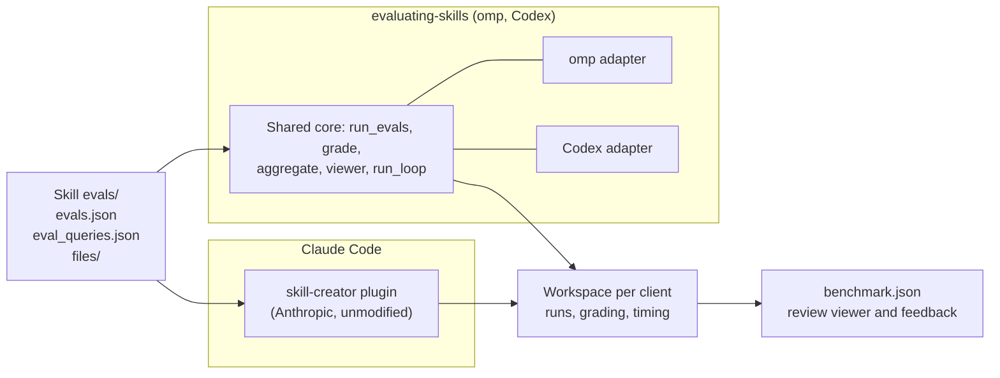

# Evaluate skills with the Agent Skills loops through each client's runner

- Date: 2026-10-30
- Status: accepted

## Context

Skill changes here were evaluated by a repository runner,
`scripts/check_activation.py` with `scripts/compare_skill.py`, over a case
format of its own in `evals/<plugin>/<skill>.json`. It checked activation,
reference reads, and forbidden actions across omp, Codex, and Claude Code,
but no client or published tool reads that format, and the runners and their
tests reached about 2,700 lines that only this repository maintains.

The Agent Skills guides define two evaluation loops with standard files:
[output quality][outputs] runs the prompts in `evals/evals.json` with and
without the skill and grades assertions with evidence, and
[description optimization][descriptions] measures trigger rates on
should-trigger and near-miss queries with a held-out split. Anthropic's
[skill-creator][creator] implements both for Claude Code. omp ships no
evaluation runner, and Codex's bundled skill-creator only validates format and
recommends forward testing.

[ADR-0005](0005-share-plugins-across-clients.md) shares plugin sources and
separates client execution; [ADR-0006](0006-keep-model-evaluations-local.md)
keeps model evaluations local in dedicated test client homes.

## Decision

Evaluate skills with the two Agent Skills loops and keep their files in each
skill's `evals/` directory. Each client uses its own runner, and only the parts
that do not depend on a client are shared:

- Claude Code uses Anthropic's skill-creator plugin unmodified.
- omp and Codex use a new `evaluating-skills` skill in `skill-workflow`. It
  ports skill-creator's client-independent parts (grader and analyzer
  instructions, benchmark aggregation, review viewer, and description loop)
  under the Apache License 2.0, and adds one adapter per client that runs a
  task, detects a skill load, and makes a tool-less model call.
- All runners write skill-creator's workspace files, so one viewer and one
  aggregation read every client's results.
- Behavior that one skill can show belongs in that skill's evals. The README
  keeps manual checks only for behavior that spans plugins, client settings,
  or installation.

The repository runners, their case format, the calibration fixtures, and the
model profile file are removed; the README lists the evaluation models instead.
The model-free packaging checks and ADR-0006's local runs in dedicated homes
stay. The current procedure, including when each loop runs and what a pull
request reports, is in the README's
[Evaluating skills](../../README.md#evaluating-skills) section.

## Rejected alternatives

- **Keep the repository runners:** they check complete body delivery,
  reference reads, forbidden writes, and multi-turn cases more strictly, but in
  a format no client tool shares, at a maintenance cost carried here alone.
- **`claude plugin eval` for Claude Code:** official and CI-ready, but its case
  files differ from the Agent Skills format that skill-creator reads, so Claude
  cases would diverge from omp and Codex cases.
- **One runner for all three clients:** uniform results, but it would replace
  the maintained Claude implementation with ours.
- **A full skill-creator copy per client:** reuses its workflow text, but its
  runner, trigger detection, and prompts assume Claude Code, and the copies
  would drift apart.
- **Fold evaluation into `authoring-skills`, as skill-creator combines both:**
  one skill would cover the whole loop, but its main file would exceed Codex's
  8,000-byte plugin-skill limit unless essential steps moved to references,
  and `skill-workflow-reviewer`, which loads the authoring guidance for static
  review, would also load evaluation procedures it never runs.

## Consequences

Cases use a published format that skill-creator also reads, and every client
produces the same workspace layout for human review. Model runs check reference
reads and forbidden actions only as graded assertions over transcripts, not
deterministically, and no longer cover complete body delivery or multi-turn
conversations; `check_plugins.py` still checks body loading without a model.
Run safety rests on dedicated homes and client sandboxes, which omp does not
provide. Trigger detection is a heuristic over each client's events, so rates
compare only within one client and model. Evaluation files ship inside plugin
packages, so changing them needs a version bump. Ported files carry Apache-2.0
notices and do not follow upstream changes automatically.

Reconsider when omp or Codex ship an evaluation runner, when skill-creator's
formats change, or when a lost guarantee lets a defect reach users.

[outputs]: https://agentskills.io/skill-creation/evaluating-skills
[descriptions]: https://agentskills.io/skill-creation/optimizing-descriptions
[creator]: https://github.com/anthropics/claude-plugins-official/tree/main/plugins/skill-creator
