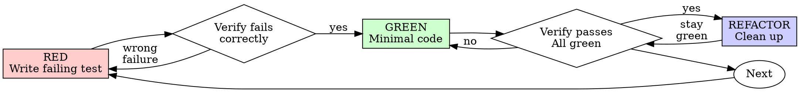

# Worked TDD Cycles

## Red-Green-Refactor



## RED - Write Failing Test

**Good:**

```typescript
test('succeeds on the third attempt after two failures', async () => {
  let attempts = 0;
  const operation = async () => {
    attempts++;
    if (attempts < 3) throw new Error('fail');
    return 'success';
  };

  const result = await retryOperation(operation);

  expect(result).toBe('success');
  expect(attempts).toBe(3);
});
```

Clear name, tests real behavior, one thing

**Bad:**

```typescript
test('retry works', async () => {
  const mock = jest.fn()
    .mockRejectedValueOnce(new Error())
    .mockRejectedValueOnce(new Error())
    .mockResolvedValueOnce('success');
  await retryOperation(mock);
  expect(mock).toHaveBeenCalledTimes(3);
});
```

Vague name, tests mock not code

## Good Tests

- **Minimal**
  - Good: One thing. "and" in name? Split it.
  - Bad: `test('validates email and domain and whitespace')`
- **Clear**
  - Good: Name describes behavior
  - Bad: `test('test1')`
- **Shows intent**
  - Good: Demonstrates desired API
  - Bad: Obscures what code should do

## GREEN - Minimal Code

**Good:**

```typescript
async function retryOperation<T>(fn: () => Promise<T>): Promise<T> {
  for (let i = 0; i < 3; i++) {
    try {
      return await fn();
    } catch (e) {
      if (i === 2) throw e;
    }
  }
  throw new Error('unreachable');
}
```

Just enough to pass

**Bad:**

```typescript
async function retryOperation<T>(
  fn: () => Promise<T>,
  options?: {
    maxRetries?: number;
    backoff?: 'linear' | 'exponential';
    onRetry?: (attempt: number) => void;
  }
): Promise<T> {
  // YAGNI
}
```

Over-engineered

## Example: Bug Fix

**Bug:** Empty email accepted

### RED

```typescript
test('rejects empty email', async () => {
  const result = await submitForm({ email: '' });
  expect(result.error).toBe('Email required');
});
```

### Verify RED

```bash
$ npm test path/to/form.test.ts
FAIL: expected 'Email required', got undefined
```

### GREEN

```typescript
function submitForm(data: FormData) {
  if (!data.email?.trim()) {
    return { error: 'Email required' };
  }
  // ...
}
```

### Verify GREEN

```bash
$ npm test path/to/form.test.ts
PASS
```

### REFACTOR

Extract validation for multiple fields if needed.
